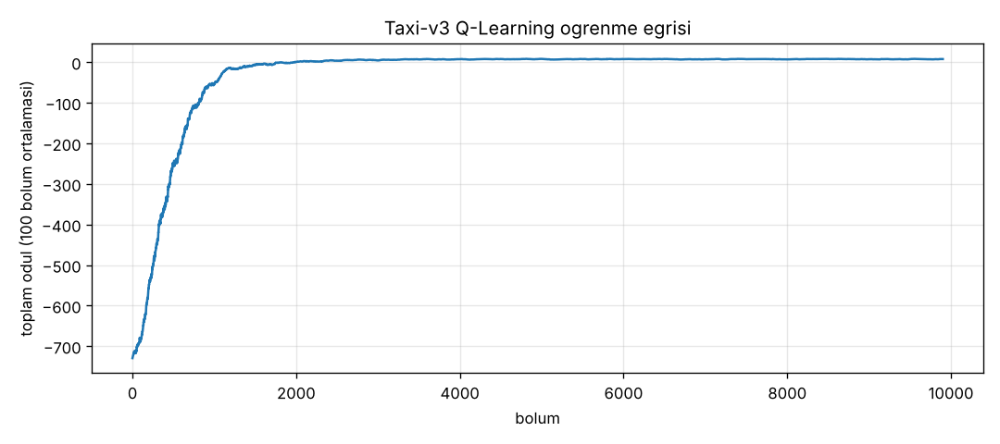

# Taxi-v3 Q-Learning

Gymnasium'daki Taxi-v3 ortamında Q-Learning ile taksi ajanı eğittim. Ajan 5x5'lik bir haritada yolcuyu bulunduğu duraktan alıp hedef durağa bırakmayı öğreniyor. Hiçbir kural yazılmadı, ajan sadece ödül ve cezalardan öğreniyor.



## Ortam

- 500 durum: taksinin konumu (25) x yolcunun yeri (5) x hedef durak (4)
- 6 aksiyon: güney, kuzey, doğu, batı, yolcu al, yolcu bırak
- Ödüller: her adım -1, yolcuyu doğru yere bırakmak +20, yanlış yerde alma/bırakma -10

Durum sayısı az olduğu için sinir ağına gerek yok, 500x6'lık bir Q tablosu yetiyor.

## Yöntem

Her adımda Q tablosu şu formülle güncelleniyor:

```
Q(s,a) <- Q(s,a) + α * (r + γ * max Q(s',a') - Q(s,a))
```

Bölüm bittiyse (yolcu teslim edildiyse) gelecekteki ödül eklenmiyor.

Aksiyon seçiminde epsilon-greedy kullandım. Başta epsilon 1, yani ajan tamamen rastgele geziyor. Her bölümden sonra epsilon 0.999 ile çarpılıyor ve 0.01'e kadar düşüyor. Böylece ajan önce ortamı keşfediyor, sonra öğrendiğini kullanmaya başlıyor.

| Parametre | Değer |
|---|---|
| α (öğrenme oranı) | 0.1 |
| γ (indirim katsayısı) | 0.99 |
| ε | 1.0'dan 0.01'e, her bölüm x0.999 |
| Bölüm sayısı | 10.000 |

Sonuçlar her çalıştırmada aynı çıksın diye numpy ve ortamın rastgele aksiyonları sabit seed ile başlatılıyor.

## Sonuçlar

İlk 1000 bölümde ajan ortalama -352 ödül alıyor, çünkü henüz rastgele geziyor ve sık sık yolcuyu teslim edemeden 200 adım sınırına takılıyor. 2000. bölümden sonra eğri düzleşiyor.

Eğitimden sonra ajanı rastgelelik olmadan, eğitimde hiç görmediği 1000 farklı başlangıçta test ettim:

| Ölçüt | Sonuç |
|---|---|
| Başarı oranı (yolcu teslim edildi) | %100 |
| Ortalama ödül | 7.96 |
| Ortalama adım | 13.04 |

Sonuçlar `sonuclar/test_sonucu.txt` dosyasında.

## Dosyalar

| Dosya | Ne işe yarıyor |
|---|---|
| `q_learning.py` | eğitim, Q tablosunu `q_tablosu.npy`'ye ve öğrenme eğrisini `sonuclar/` klasörüne kaydediyor |
| `test.py` | eğitilen ajanı 1000 yeni bölümde test ediyor |
| `izle.py` | ajanın bir bölümü nasıl çözdüğünü konsolda adım adım gösteriyor |
| `q_tablosu.npy` | eğitilmiş Q tablosu, eğitim yapmadan test ve izleme için |

## Çalıştırma

```
pip install -r requirements.txt
python q_learning.py
python test.py
python izle.py
```

Gymnasium'un yeni sürümlerinde Taxi-v3 kaldırıldığı için `requirements.txt` içinde 1.1.1 sürümü sabitlendi.
